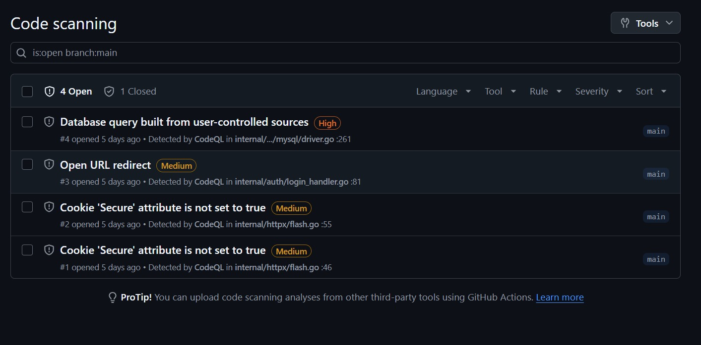
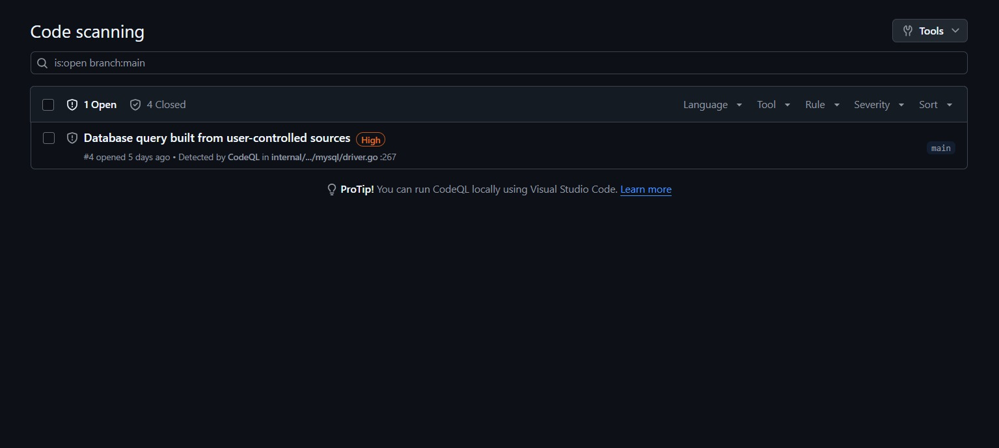
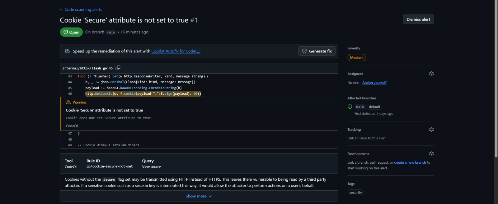
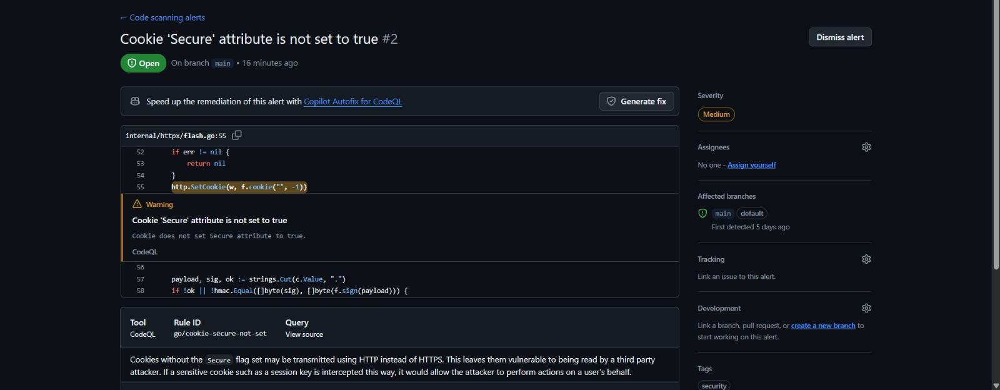
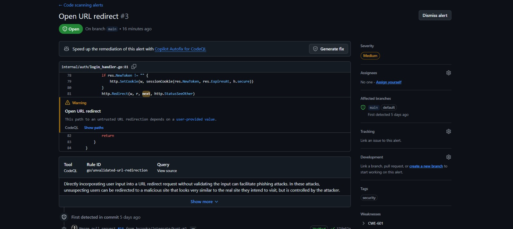
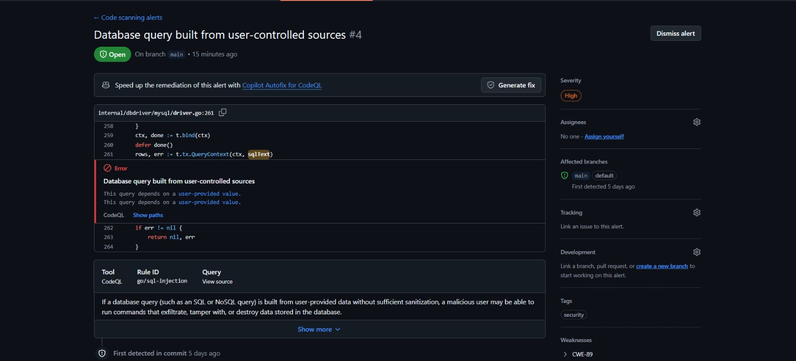

# Database Management Platform

Tugas Besar IF3110 Pengembangan Aplikasi Web, Milestone 2, kelompok K02-G10.

Platform untuk mengelola akses, menjelajah database, dan menjalankan migration PostgreSQL dengan persetujuan leader, antrean, worker asynchronous, mode batch, rollback, serta log dan trace terstruktur. Backend dan worker ditulis dengan Go, frontend berupa SPA React.

- [Menjalankan](#menjalankan)
- [Arsitektur](#arsitektur)
- [Session](#session)
- [Akses ke database](#akses-ke-database)
- [Migration](#migration)
- [Uji data besar](#uji-data-besar)
- [Logging dan tracing](#logging-dan-tracing)
- [Bonus](#bonus)
- [Pembagian tugas](#pembagian-tugas)

## Menjalankan

Yang perlu ada: Docker. Server, worker, SPA, dan database berjalan di container.

```bash
cp .env.example .env
```

Isi dua nilai di `.env`:

- `APP_SECRET_KEY`: base64 dari tepat 32 byte acak untuk mengenkripsi password koneksi database.
  - Linux/macOS: `openssl rand -base64 32`
  - PowerShell: `$b = New-Object byte[] 32; [Security.Cryptography.RandomNumberGenerator]::Create().GetBytes($b); [Convert]::ToBase64String($b)`
- `SEED_ADMIN_PASSWORD`: password untuk Platform Admin pertama. Username-nya `admin`, bisa diganti lewat `SEED_ADMIN_USERNAME`.

Lalu:

```bash
docker compose --profile app up --build -d server worker   # atau: make app-up
```

Buka http://localhost:8080. Untuk menghentikan: `docker compose --profile app down` (`make app-down`).

Data platform disimpan di volume `appdb_data`. Database contoh (`targetdb`) tidak memakai volume bernama, jadi isinya dibuat ulang kalau container-nya dihapus, sementara riwayat di platform tetap ada.

### Mencoba alur lengkap

1. Masuk sebagai `admin`. Di menu **Koneksi**, tambahkan database contoh: host `targetdb`, port `5432`, database `sampledb`, user `postgres`, password `postgres`, SSL `disable`.
2. Di menu **Pengguna**, buat dua user, misalnya `editor` dan `leader`.
3. Di menu **Group**, buat group, tambahkan keduanya sebagai anggota, tetapkan `leader` sebagai leader, lalu beri group akses **View + Edit** ke koneksi tadi.
4. Masuk sebagai `editor`. Buka database, pilih **Migration**, lalu **Buat migration**. Isi SQL up dan SQL down, simpan, **Bekukan**, lalu **Ajukan apply**.
5. Masuk sebagai `leader`, buka **Persetujuan**, lalu setujui.
6. Masuk lagi sebagai `editor`, buka permintaannya, klik **Jalankan**, dan pantau statusnya sampai selesai.
7. Lihat **Riwayat eksekusi**, lalu coba **Ajukan rollback**.

Platform Admin tidak otomatis punya akses ke isi database. Kalau admin ingin mengerjakan migration, masukkan akunnya ke group.

### Pengembangan tanpa container aplikasi

Yang perlu ada: Go 1.26, Node 20, dan Docker untuk database.

```bash
make up            # appdb (5432), targetdb (5433), testdb (5434)
make build-web     # build SPA ke web/dist
make run           # server di http://localhost:8080
make run-worker    # di terminal kedua
```

Isi `WEB_DIST_DIR=web/dist` di `.env` sebelum `make run`. **Tanpa nilai itu server menyajikan halaman HTML lama dari Milestone 1, yang tidak memuat migration.** Tanpa worker, permintaan yang dijalankan akan tertahan di antrean.

Saat mengubah tampilan, `npm run dev` di folder `frontend/` menjalankan Vite di http://localhost:5173 dengan proxy `/api` ke server.

Dari dalam container, database contoh dicapai lewat `targetdb:5432`. Dari server yang berjalan di host, pakai `localhost:5433`.

### Test

```bash
make test-short    # unit test saja, tidak butuh Docker
make up && make test   # semua test, memakai testdb di port 5434
make test-docker   # semua test di dalam container Go
```

Unit test memakai pengganti (fake) untuk dependency. Integration test menjalankan database sungguhan, memanggil service, handler API, dan worker, serta mencakup alur berhasil, kegagalan, dan penolakan akses. GitHub Actions menjalankan `gofmt`, `go vet`, `go test`, dan build frontend pada setiap push dan pull request ke `main`.

## Arsitektur

```
Browser (SPA React)
      │  /api/v1  (cookie session + CSRF)
      ▼
   server ───────────────► appdb (PostgreSQL platform)
      │                      ▲   user, group, koneksi, migration,
      │ schema, data,        │   persetujuan, antrean job, riwayat
      │ EXPLAIN              │
      ▼                      │
  database target ◄────── worker
  (PostgreSQL)               ambil job, kunci, jalankan SQL,
                             tulis bukti di schema _dbplatform
```

Server hanya mencatat permintaan dan memasukkan job ke antrean, lalu langsung membalas dengan job ID. SQL migration hanya dijalankan worker. Antrean disimpan di tabel database platform, jadi tidak perlu message broker terpisah dan job tetap ada setelah proses dimulai ulang.

### Struktur kode

```
cmd/server/          titik masuk server, perakitan modul, peta route (routes.go), test end-to-end
cmd/worker/          titik masuk worker
internal/apiv1/      router /api/v1, bentuk respons, penyajian SPA
internal/auth/       login, password, session, CSRF, middleware
internal/access/     perhitungan akses efektif, semua keputusan "boleh atau tidak"
internal/admin/      user, group, keanggotaan, leader, pemberian akses
internal/connmgr/    koneksi database, enkripsi kredensial, cache driver
internal/viewer/     penjelajah schema, tabel, dan data
internal/migration/  definisi, alur status, persyaratan, runner normal dan batch, riwayat
internal/approval/   persetujuan leader
internal/queue/      antrean job, lease, kunci per database, retry
internal/dbdriver/   antarmuka driver, postgres/, mysql/, log SQL (obs/), bukti eksekusi (pgmeta/)
internal/explain/    EXPLAIN dan EXPLAIN ANALYZE (bonus)
internal/schemadiff/ perbandingan schema (bonus)
internal/telemetry/  log JSON, tracing, metrik, penyamaran data sensitif
internal/appdb/sql/  skema database platform
internal/...         config, domain, contract, clock, middleware, httpx (halaman HTML lama)
frontend/            SPA React, TypeScript, TanStack Query, Tailwind
web/                 aset yang di-embed dan hasil build SPA (web/dist)
loadtest/            skrip k6 (bonus)
docker/              database contoh dan konfigurasi observability
```

## Session

Setelah login, browser hanya menerima satu nilai acak 32 byte di cookie `wbd_session`. 

Semua parameter bisa diubah lewat `.env`:

| Parameter                     | Bawaan   | Alasan                                                                                                                                     |
| ----------------------------- | -------- | ------------------------------------------------------------------------------------------------------------------------------------------ |
| `SESSION_IDLE_TIMEOUT`      | 30 menit | Cukup panjang untuk membaca hasil query atau menyusun migration, tapi komputer yang ditinggal tidak terbuka seharian.                      |
| `SESSION_ABSOLUTE_TIMEOUT`  | 12 jam   | Kira-kira satu hari kerja. Cookie yang dicuri tetap kedaluwarsa walaupun terus dipakai.                                                    |
| `SESSION_ROTATION_INTERVAL` | 15 menit | Memperpendek umur satu nilai cookie tanpa terlalu sering menulis ke database.                                                              |
| `SESSION_GRACE_PERIOD`      | 30 detik | Cukup untuk request yang berjalan bersamaan saat rotasi terjadi. Harus lebih kecil dari interval rotasi, kalau tidak server menolak jalan. |

Setiap request ke halaman yang dilindungi diperiksa dengan urutan, session sudah dicabut, lewat batas absolut, terlalu lama diam, lalu user sudah dinonaktifkan. Kalau salah satu terpenuhi, session ditolak dan pengguna diarahkan ke halaman login. Waktu aktivitas terakhir hanya diperbarui paling sering sekali per menit. Akibatnya idle timeout bisa meleset sampai satu menit, sebagai ganti tidak menulis ke database di setiap klik.

**Rotasi.** Nilai cookie diganti saat login (selalu session baru, dan session lama dari cookie yang dibawa ikut dicabut), setiap 15 menit, dan ketika privilege seseorang naik: dijadikan admin, ditambahkan ke group, atau level akses group-nya dinaikkan. Nama cookie tetap, hanya nilainya yang berubah. Rotasi tidak memperpanjang batas 12 jam.

**Grace period.** Setelah rotasi, nilai lama masih diterima selama 30 detik, supaya request paralel atau response yang terlambat tidak membuat pengguna tiba-tiba keluar. Request yang datang dengan nilai lama tidak memicu rotasi lagi. Lewat 30 detik, nilai lama ditolak.

Ada satu batasan yang kami terima. Kalau response yang membawa cookie baru benar-benar hilang di jalan dan browser tidak mengirim request lain dalam 30 detik, pengguna harus login ulang. Memperpanjang grace period menutup celah ini, tapi juga memperpanjang umur cookie lama.

**Logout dan pencabutan** selalu terjadi di backend (kolom `revoked_at`), bukan sekadar menghapus cookie. Menonaktifkan user atau mengganti password-nya mencabut semua session milik user tersebut.

Semua request yang mengubah data membawa token CSRF yang terikat ke session (header `X-CSRF-Token` pada API). Server juga memeriksa header `Origin` atau `Referer`. Form login punya token sendiri lewat cookie terpisah, karena saat itu session belum ada.

Password di-hash dengan bcrypt (cost 12). Password, cookie, dan isi form tidak pernah ditulis ke log. Pesan gagal login sama persis untuk password salah maupun username yang tidak ada.

## Akses ke database

- **View Only**: melihat schema, data, migration, dan riwayatnya.
- **View + Edit**: semua yang di atas, ditambah membuat dan mengubah draft, mengajukan, membatalkan, dan menjalankan permintaan, EXPLAIN, serta schema diff.

Satu group bisa punya level berbeda di tiap database.

**Akses efektif adalah level tertinggi** dari semua group yang diikuti user untuk database tersebut. Kalau Budi ada di group `analis` (View Only) dan `backend` (View + Edit) yang sama-sama punya akses ke `sales`, maka Budi bisa mengedit `sales`. Kami memilih aturan ini karena tujuan memasukkan seseorang ke group adalah memberi kemampuan. Kalau ingin membatasi, keluarkan dia dari group yang lebih tinggi.

Akses dihitung ulang dari database pada setiap request, tanpa cache. Mengeluarkan user dari group atau mencabut akses group langsung berlaku di request berikutnya.

**Platform Admin bukan level akses database.** Admin mengelola user, group, koneksi, dan pemberian akses, tapi tidak otomatis bisa membuka isi database. Dengan begitu, siapa yang benar-benar membaca data selalu terlihat dari daftar group.

Koneksi yang dinonaktifkan tidak bisa diakses siapa pun sampai diaktifkan kembali.

## Migration

### Definisi

Setiap migration punya nomor versi yang naik berurutan per database dan tidak pernah dipakai ulang, nama, **SQL up**, **SQL down** atau tanda **irreversible** beserta alasannya, mode **normal** atau **batch**, dan nomor revisi. Draft boleh disimpan berkali-kali. Penyimpanan ditolak kalau revisi yang diubah sudah basi, sehingga perubahan orang lain tidak tertimpa.

**Bekukan** mengunci SQL. Draft hanya bisa dibekukan kalau punya SQL down atau ditandai irreversible. Migration beku yang belum punya permintaan terbuka dan belum pernah dijalankan bisa **dibuka lagi**, dan revisinya naik. Setelah pernah dieksekusi, SQL up dan down tidak bisa diubah. Untuk memperbaikinya, buat migration baru (tombol **Salin ke migration baru**).

SQL tidak boleh berisi perintah pengatur transaction (`BEGIN`, `COMMIT`, `ROLLBACK`, dan sejenisnya) atau perintah yang tidak bisa berjalan di dalam transaction (misalnya `CREATE INDEX CONCURRENTLY`, `VACUUM`). SQL maksimal 256 KB.

### Alur dan status

```
Draft ─ bekukan ─► Siap diajukan ─ ajukan ─► Menunggu persetujuan ─ semua leader setuju ─► Disetujui
      ─ jalankan ─► Dalam antrean ─► Berjalan ─► Berhasil / Gagal / Setengah jalan / Hasil belum pasti
```

Status disimpan di dua tempat. **Status permintaan** menggambarkan satu pengajuan: `pending_review`, `approved`, `rejected`, `cancelled`, `queued`, `running`, `success`, `failed`, `partial`, `partially_reverted`, `outcome_unknown`. **Status migration** menggambarkan posisi perubahan di database:

| Status migration | Arti |
|---|---|
| `draft` | masih bisa diubah |
| `ready` | beku, siap diajukan |
| `applied` | perubahan aktif di database |
| `failed` | gagal tanpa ada yang tercommit |
| `rolled_back` | sudah dibatalkan dengan SQL down |
| `partial` | sebagian batch tercommit |
| `partially_reverted` | pembatalan batch baru sebagian |
| `unknown` | belum bisa dipastikan tercommit atau tidak |
| `cancelled`, `superseded` | tidak akan dijalankan lagi |

### Persetujuan

Setiap permintaan, termasuk rollback, forward, dan resume, butuh persetujuan **leader dari setiap group yang punya akses** ke database tersebut, baik View Only maupun View + Edit.

- Permintaan ditolak sejak awal kalau ada group berakses yang belum punya leader.
- Kalau pengaju adalah leader sebuah group, persetujuan group itu tercatat otomatis.
- Satu penolakan mengakhiri permintaan, dan alasannya wajib diisi.
- Tepat sebelum eksekusi, worker memeriksa ulang: pengaju masih aktif dan punya akses View + Edit, koneksi aktif, semua group yang **sekarang** punya akses sudah menyetujui, SQL sama dengan yang disetujui (checksum dihitung ulang), dan urutan versinya masih sah. Group yang baru mendapat akses setelah pengajuan membuat permintaan gagal dengan kode `approval_stale`.

### Urutan, rollback, dan forward

- **Apply** dan **forward** mengikuti urutan versi. Versi di bawahnya yang masih `draft`, `ready`, `rolled_back`, `partial`, `partially_reverted`, atau `unknown` menahan versi di atasnya. Versi `failed` tidak menahan. Versi tidak bisa dimasukkan kalau versi yang lebih tinggi sudah aktif.
- **Rollback** hanya untuk migration aktif paling akhir (untuk A → B → C, C harus di-rollback sebelum B), memakai SQL down asli dari migration itu, dan merujuk ID eksekusi yang dibatalkan. Migration irreversible tidak bisa di-rollback.
- **Forward** menjalankan kembali SQL up pada migration `failed` atau `rolled_back`, sebagai eksekusi baru, tanpa otomatis menjalankan versi berikutnya.
- **Supersede** menandai migration `failed` atau `rolled_back` tidak akan dicoba lagi, supaya tidak menahan versi di atasnya.
- Selama satu database punya migration `partial`, `partially_reverted`, atau `unknown`, migration lain di database itu ditolak.

### Riwayat

Setiap percobaan, berhasil maupun gagal, termasuk retry, dicatat sebagai satu baris: ID migration, ID eksekusi, versi dan revisi, pengguna yang mengajukan, waktu, status, jumlah batch dan baris, kode serta pesan kegagalan, `correlation_id`, dan **salinan SQL yang benar-benar dijalankan** (kosong kalau gagal sebelum SQL dijalankan). Tabel riwayat hanya bisa ditambah, perubahan dan penghapusan ditolak oleh trigger database.

Pilihan **Hide rollback** menyembunyikan eksekusi yang dibatalkan beserta rollback sukses yang membatalkannya, dipasangkan berdasarkan ID eksekusi. Kegagalan tetap tampil, dan data tidak dihapus.

### Mode normal dan batch

**Normal** menjalankan seluruh SQL up dalam satu transaction. Kalau satu perintah gagal, semuanya di-rollback. Batas waktunya 30 menit.

**Batch** memproses data bertahap, satu transaction per batch:

- SQL harus satu statement `UPDATE`, `INSERT`, atau `DELETE` yang memakai `$1` (batas bawah, tidak ikut) dan `$2` (batas atas, ikut), misalnya `UPDATE t SET x = 1 WHERE id > $1 AND id <= $2`. SQL down memakai pola yang sama.
- Kolom kunci harus integer dan primary key atau unique.
- Ukuran batch 1 sampai 100.000 baris, bawaan 10.000.
- Batas atas ditentukan sekali di awal, jadi baris yang masuk setelahnya tidak ikut diproses. Batas tiap batch dicari dengan kursor (`kunci > terakhir ORDER BY kunci LIMIT ukuran`), tanpa memuat dataset ke memory.
- Checkpoint (eksekusi, nomor batch, arah, rentang kunci, jumlah baris) ditulis ke `_dbplatform.batches` **di transaction yang sama** dengan perubahannya.
- Kalau satu batch gagal, hanya batch itu yang dibatalkan, batch sebelumnya tetap tercommit. Statusnya `partial` kalau sudah ada batch tercommit dan `failed` kalau belum. Yang `partial` tidak diulang otomatis.
- **Resume** melanjutkan dari checkpoint terakhir. **Rollback** menjalankan SQL down per batch dalam urutan terbalik, dan bisa dilanjutkan kalau berhenti di tengah (`partially_reverted`). Keduanya tetap butuh persetujuan.

### Antrean, kunci, dan retry

- Satu database hanya menjalankan satu migration pada satu waktu, sedangkan database berbeda berjalan paralel (`WORKER_CONCURRENCY`, bawaan 4).
- Ada dua kunci. Tabel `connection_locks` di platform mencegah dua worker mengambil job untuk database yang sama. **Advisory lock** di database target dipegang selama job berjalan, termasuk di antara commit batch.
- Worker memegang **lease** 30 detik yang diperpanjang tiap 10 detik. Setiap pengambilalihan menaikkan nomor **fence**, sehingga tulisan dari worker lama ditolak.
- Gangguan sementara (koneksi terputus, deadlock, serialization failure, server target belum siap) dicoba paling banyak 3 kali, dengan jeda 5 detik lalu 15 detik (`JOB_MAX_ATTEMPTS`, `JOB_RETRY_BASE`). Kesalahan SQL dan habis batas waktu tidak diulang.
- Bukti commit ditulis ke `_dbplatform.executions` di transaction yang sama dengan SQL migration. Job yang terkirim dua kali melihat bukti itu dan tidak menjalankan SQL lagi.

### Pemulihan saat worker mati

1. Koneksi worker ke database target terputus. PostgreSQL membatalkan transaction yang belum di-commit dan melepas advisory lock. Kalau saat itu masih ada statement yang berjalan, keduanya baru terjadi setelah statement itu selesai.
2. Kunci di platform tetap tercatat sampai lease habis (paling lama 30 detik).
3. Pemeriksa (tiap 10 detik) di worker yang hidup mengambil alih job dengan fence baru, lalu **mengecek bukti di database target** sebelum memutuskan apa pun:
   - ada bukti selesai: dicatat berhasil tanpa menjalankan SQL lagi;
   - mode normal tanpa bukti: pasti tidak tercommit, dicatat gagal lalu dicoba ulang selama jatah percobaan masih ada;
   - mode batch tanpa bukti selesai: jumlah batch dibaca dari checkpoint, dicatat `partial` kalau sudah ada yang tercommit, kalau belum dicoba ulang;
   - bukti tidak bisa diperiksa: `outcome_unknown`.

Kalau advisory lock masih dipegang koneksi lama, job dijadwalkan ulang sampai kunci bisa diambil.

### Menyelesaikan hasil belum pasti

`outcome_unknown` terjadi kalau hasil commit tidak bisa diperiksa, misalnya database target tidak terjangkau. Database itu sengaja diblok, dan **belum ada tombol di aplikasi** untuk menyelesaikannya. Langkah manual:

1. Cari permintaannya di database platform (`docker compose exec appdb psql -U postgres -d dbplatform`):

   ```sql
   SELECT id, migration_id, connection_id, version, kind, mode, root_execution_id
   FROM migration_executions WHERE status = 'outcome_unknown';
   ```

2. Setelah database target bisa dihubungi, periksa buktinya di sana. Ganti `7` dengan ID permintaan:

   ```sql
   SELECT * FROM _dbplatform.executions WHERE execution_id = 7;
   SELECT * FROM _dbplatform.batches WHERE execution_id = 7 ORDER BY batch_no;
   ```

3. Tentukan status dari bukti, lalu samakan di database platform:

   | Bukti di target | Jenis | Status permintaan | Status migration |
   |---|---|---|---|
   | ada baris di `executions` | apply atau forward | `success` | `applied` |
   | ada baris di `executions` | rollback | `success` | `rolled_back` |
   | tidak ada, tanpa batch | apply atau forward | `failed` | `failed` |
   | tidak ada, tanpa batch | rollback | `failed` | `applied` |
   | hanya sebagian di `batches` | apply atau forward | `partial` | `partial` |
   | hanya sebagian di `batches` | rollback | `partially_reverted` | `partially_reverted` |

   ```sql
   BEGIN;
   UPDATE migration_executions SET status = 'success' WHERE id = 7 AND status = 'outcome_unknown';
   UPDATE db_migrations SET state = 'applied', updated_at = now()
   WHERE id = (SELECT migration_id FROM migration_executions WHERE id = 7) AND state = 'unknown';
   COMMIT;
   ```

Baris riwayat tetap mencatat `outcome_unknown` karena riwayat tidak boleh ditimpa. Untuk resume atau rollback yang gagal tanpa perubahan baru, status migration kembali ke posisi sebelumnya (`partial` atau `applied`).

### Asumsi dan keterbatasan

- Migration hanya didukung untuk **PostgreSQL**. User koneksi butuh hak `CREATE` untuk membuat schema `_dbplatform` di database target.
- Riwayat ada di database platform sedangkan perubahan ada di database target. Keduanya tidak bisa di-commit atomik, karena itu bukti ditulis di target dan diperiksa saat hasilnya tidak pasti.
- Bukti dikenali dari ID eksekusi, checksum, jenis, dan waktunya (toleransi selisih jam 1 menit). Kalau database platform dibuat ulang sementara target masih menyimpan bukti lama, eksekusi ditolak dengan kode `target_conflict`. Hapus schema `_dbplatform` hanya kalau datanya memang tidak dipakai lagi.
- Kolom kunci batch harus **tidak pernah berubah** selama migration berjalan. Platform memeriksa tipe dan keunikannya, tetapi tidak bisa memastikan nilainya tetap.
- SQL down ditulis pengguna. Platform tidak menyimpan nilai lama baris, jadi SQL down tidak menjamin data yang sudah dihapus bisa kembali. Perubahan seperti itu sebaiknya ditandai irreversible.
- Migration dari Milestone 1 dikonversi otomatis: yang berhasil menjadi `applied` dan irreversible (M1 tidak punya SQL down), yang gagal menjadi `superseded`, dan yang masih berjalan menjadi `unknown`.

## Uji data besar

`make seed-large` membuat tabel `public.events` berisi 3 juta baris di `sampledb` (319 MB). Jumlah baris bisa diubah dengan `ROWS=500000`. Tanpa `make`:

```powershell
Get-Content docker/targetdb/large.sql -Raw | docker compose exec -T targetdb psql -U postgres -d sampledb -v ON_ERROR_STOP=1 -1 -f -
```

Pengukuran pada 27 November 2026 lewat platform (permintaan, antrean, worker), dengan PostgreSQL 16 di Docker pada laptop pengembang (8 CPU, 16 GB). Dataset yang sama dipakai untuk kedua mode, dan `VACUUM FULL` dijalankan di antaranya. SQL up menggeser `created_at` satu jam, SQL down mengembalikannya. Setiap angka dari satu kali percobaan.

| Mode | Operasi | Baris | Transaction | Durasi total |
|---|---|---|---|---|
| Normal | apply | 3.000.000 | 1 | 62,5 detik |
| Normal | rollback | 3.000.000 | 1 | 45,3 detik |
| Batch 10.000 | apply | 3.000.000 | 300 batch | 51,0 detik |
| Batch 10.000 | rollback | 3.000.000 | 300 batch | 60,9 detik |

| Lama satu transaction batch | Median | p95 | Terlama |
|---|---|---|---|
| apply | 145 ms | 282 ms | 387 ms |
| rollback | 180 ms | 352 ms | 1.836 ms |

Setelah tiap apply, seluruh 3.000.000 baris terbukti bergeser, dan setelah tiap rollback seluruhnya kembali ke nilai awal.

Total waktu kedua mode tidak jauh berbeda. Keuntungan batch ada pada transaction yang pendek: baris terkunci jauh lebih singkat, kemajuan tersimpan sehingga bisa dilanjutkan, dan kegagalan hanya membatalkan satu batch.

## Logging dan tracing

Server dan worker menulis log JSON (`log/slog`) ke stdout. Log tidak disimpan di database platform.

- **Atribut:** waktu, level, `event`, `actor`, `database` atau `connection_id`, status, `correlation_id`, serta `trace_id` dan `span_id`.
- **Log SQL** ke database target: `sql.start` dan `sql.result` memuat query, parameter, durasi, jumlah baris, dan error beserta SQLSTATE. Di worker ditambah `migration_id`, `execution_id`, `job_id`, `attempt`, `requested_by`, dan `batch`. Awal dan akhir transaction dicatat terpisah (`tx.begin`, `tx.commit`, `tx.rollback`).
- **Aktivitas:** login, perubahan definisi, pengajuan, keputusan persetujuan, antrean, job, kunci, batch, dan setiap percobaan (`migration.attempt`, berisi salinan SQL).
- **Penyamaran:** atribut yang namanya memuat password, token, secret, cookie, authorization, csrf, atau session diganti `[REDACTED]`, begitu juga literal password di dalam SQL.
- **Pembacaan dan uji koneksi:** pembacaan schema (`op` `introspect`) dan isi tabel (`table_data`) mencatat setiap query katalog dan `SELECT` halaman yang benar-benar dikirim, beserta parameternya. Uji koneksi dicatat sebagai `connect`, termasuk yang gagal. Ping PostgreSQL tercatat `-- ping` (statement yang dikirim pgx), sedangkan MySQL memakai perintah protokol `COM_PING`, bukan SQL.
- **Keterbatasan:** nilai data di dalam teks SQL tidak disamarkan, kecuali literal password.

**Korelasi.** Job memakai `correlation_id` milik pengajuan, sehingga pengajuan, kerja worker, dan riwayat bisa dicari dengan satu ID. Request **Jalankan** punya `correlation_id` sendiri, dan terhubung ke job lewat **span link** pada trace.

**Tracing** memakai OpenTelemetry: request API → antrean (`traceparent` disimpan di job) → `queue.job` di worker → `migration.lock` → `migration.batch` → `db.query`. Span mencatat durasi dan error. Bawaannya diekspor ke console (`OTEL_TRACES_EXPORTER=console`), atau `otlp` untuk dikirim ke Collector.

### Contoh log

Satu migration batch (versi 3, 5 baris, ukuran batch 3), dari `docker logs` server dan worker. Hanya sebagian baris yang ditampilkan.

```json
{"time":"2026-11-27T00:32:07.655998979Z","level":"INFO","msg":"migration execution changed","event":"migration.requested","actor":"uilead","connection_id":1,"migration_id":3,"execution_id":5,"version":3,"kind":"apply","status":"approved","correlation_id":"9ec69e0953a905c5","trace_id":"8528d6d31f45eaf2572fd2d6e2b0388f","span_id":"f5e4f96308ae7246"}
{"time":"2026-11-27T00:32:07.675283832Z","level":"INFO","msg":"migration execution changed","event":"migration.queued","actor":"uilead","connection_id":1,"migration_id":3,"execution_id":5,"version":3,"kind":"apply","status":"approved","correlation_id":"4cb54687229b4695","trace_id":"5645f63598c8a20033122d65b841930a","span_id":"f814973f2cc70c36"}
{"time":"2026-11-27T00:32:08.331395495Z","level":"INFO","msg":"job claimed","worker_id":"f2d03662fbd0-1","job_id":"175cc7c5-9a60-4757-a440-1bc2ee085425","execution_id":5,"attempt":1,"actor":"system","event":"job.claimed","fence":5,"correlation_id":"9ec69e0953a905c5","trace_id":"8baf385830584a5b85b581760a42e6fc","span_id":"bd95d906ef0567cb"}
{"time":"2026-11-27T00:32:08.378631786Z","level":"INFO","msg":"sql start","worker_id":"f2d03662fbd0-1","event":"sql.start","actor":"system","database":"data-besar","op":"exec","query":"UPDATE public.contoh SET total = 1 WHERE id > $1 AND id <= $2","params":[0,3],"correlation_id":"9ec69e0953a905c5","trace_id":"8baf385830584a5b85b581760a42e6fc","span_id":"a126a2b160fe0dae","migration_id":3,"execution_id":5,"job_id":"175cc7c5-9a60-4757-a440-1bc2ee085425","attempt":1,"requested_by":"uilead","batch":1}
{"time":"2026-11-27T00:32:08.380028358Z","level":"INFO","msg":"sql result","worker_id":"f2d03662fbd0-1","event":"sql.result","status":"ok","actor":"system","database":"data-besar","op":"exec","query":"UPDATE public.contoh SET total = 1 WHERE id > $1 AND id <= $2","params":[0,3],"duration_ms":1,"rows":3,"correlation_id":"9ec69e0953a905c5","trace_id":"8baf385830584a5b85b581760a42e6fc","span_id":"a126a2b160fe0dae","migration_id":3,"execution_id":5,"job_id":"175cc7c5-9a60-4757-a440-1bc2ee085425","attempt":1,"requested_by":"uilead","batch":1}
{"time":"2026-11-27T00:32:08.38420037Z","level":"INFO","msg":"transaction end","worker_id":"f2d03662fbd0-1","actor":"system","database":"data-besar","event":"tx.commit","status":"ok","duration_ms":9,"correlation_id":"9ec69e0953a905c5","trace_id":"8baf385830584a5b85b581760a42e6fc","span_id":"3a4f45abc0a2c6a9","migration_id":3,"execution_id":5,"job_id":"175cc7c5-9a60-4757-a440-1bc2ee085425","attempt":1,"requested_by":"uilead","batch":1}
{"time":"2026-11-27T00:32:08.384396608Z","level":"INFO","msg":"batch committed","worker_id":"f2d03662fbd0-1","event":"migration.batch_committed","batch":1,"direction":"forward","lo":0,"hi":3,"rows":3,"correlation_id":"9ec69e0953a905c5","trace_id":"8baf385830584a5b85b581760a42e6fc","span_id":"bd95d906ef0567cb","migration_id":3,"execution_id":5,"job_id":"175cc7c5-9a60-4757-a440-1bc2ee085425","attempt":1,"requested_by":"uilead"}
{"time":"2026-11-27T00:32:08.407039214Z","level":"INFO","msg":"migration attempt finished","worker_id":"f2d03662fbd0-1","event":"migration.attempt","actor":"uilead","connection_id":1,"migration_id":3,"execution_id":5,"job_id":"175cc7c5-9a60-4757-a440-1bc2ee085425","version":3,"revision":1,"kind":"apply","attempt":1,"status":"success","committed":true,"failure_code":"","error":"","query":"UPDATE public.contoh SET total = 1 WHERE id > $1 AND id <= $2","correlation_id":"9ec69e0953a905c5","trace_id":"8baf385830584a5b85b581760a42e6fc","span_id":"bd95d906ef0567cb"}
```

### Contoh span

Ringkasan dari keluaran exporter console untuk eksekusi yang sama:

```
trace 5645f635…  dbplatform-api
  POST /api/v1/executions/5/run             9 ms    status 202

trace 8baf3858…  dbplatform-worker
  queue.job                                84.8 ms  execution.id=5  link -> 5645f635…
    db.query                                1.4 ms  SELECT 1
    migration.lock                          1.0 ms  lock.acquired=true
      db.query                              0.9 ms  SELECT pg_try_advisory_lock($1)
    db.query  (10 span persiapan: tabel _dbplatform, pemeriksaan bukti, kolom kunci, checkpoint, batas)
    migration.batch                         9.5 ms  batch.number=1  batch.rows=3
      db.query                              2.4 ms  SELECT max(k)::bigint FROM (...)
      db.query                              1.5 ms  UPDATE public.contoh SET total = 1 WHERE id > $1 AND id <= $2
      db.query                              1.0 ms  INSERT INTO _dbplatform.batches (...)
    migration.batch                         7.6 ms  batch.number=2  batch.rows=2
    migration.batch                         3.6 ms  batch.number=3  batch.empty=true
    db.query                                1.0 ms  INSERT INTO _dbplatform.executions (...)
```

## Bonus

### Query execution plan

Halaman **Query plan** pada sebuah database menjalankan `EXPLAIN`, atau `EXPLAIN ANALYZE` kalau kotaknya dicentang. Hasilnya ditampilkan sebagai pohon node: jenis scan, index, strategi join, kondisi, estimasi cost dan baris, serta untuk ANALYZE waktu aktual, baris aktual, loops, dan buffer. JSON mentahnya juga tersedia. Statement yang sama bisa langsung **disimpan sebagai draft** migration. Hanya untuk pengguna View + Edit.

ANALYZE benar-benar menjalankan statement, jadi selalu dibungkus transaction yang di-rollback, dengan batas 15 detik. Hanya satu statement DML yang diterima (`SELECT`, `INSERT`, `UPDATE`, `DELETE`, `WITH`, `VALUES`).

### Schema diff

Dari halaman migration, pengguna View + Edit bisa membandingkan struktur database tujuan dengan database PostgreSQL lain yang ia punya akses baca. Hasilnya daftar perbedaan beserta SQL-nya (schema dan tabel baru, kolom, constraint, index). Perubahan yang bisa menghapus data tidak dicentang secara bawaan. Server menghitung ulang perbedaan saat draft dibuat, jadi browser tidak pernah mengirim SQL. Draft yang dihasilkan belum punya SQL down, sehingga harus dilengkapi atau ditandai irreversible sebelum dibekukan.

### MySQL dan MariaDB

Koneksi bisa bertipe PostgreSQL, MySQL, atau MariaDB. **Viewer dan EXPLAIN** bekerja untuk ketiganya, sedangkan **migration hanya untuk PostgreSQL**. Database contoh MySQL: `docker compose --profile mysql up -d targetmysql` (port 3307, user `root`, password `root`, database `sampledb`).

### Observability

```
make obs-up     # OpenTelemetry Collector, Tempo, Loki, Prometheus, Grafana
make obs-down
```

Grafana di http://localhost:3000 langsung membuka dashboard **DB Platform**. Agar server dan worker mengirim trace dan log, isi di `.env`:

```
OTEL_TRACES_EXPORTER=otlp
OTEL_LOGS_EXPORTER=otlp
OTEL_EXPORTER_OTLP_ENDPOINT=http://localhost:4318   # server di container profil app otomatis memakai http://otel-collector:4318
```

| Sinyal | Jalur | Penyimpanan |
|---|---|---|
| Trace | aplikasi → OTLP → Collector | Tempo; Collector juga membuat metrik durasi span (`spanmetrics`) |
| Log | stdout JSON tetap ada; salinannya lewat OTLP → Collector | Loki |
| Metrik | Prometheus men-scrape `/metrics` server (8080) dan worker (9091) | Prometheus |

Konfigurasi ada di `docker/observability/`: `otel-collector.yaml`, `tempo.yaml`, `prometheus.yml`, datasource dan dashboard Grafana yang di-provision sehingga bisa dijalankan ulang. Datasource saling terhubung: dari baris log di Loki ada tombol ke trace-nya di Tempo, dan dari span ada tombol ke log dengan trace yang sama.

Metrik yang tersedia:

- **Queue dan job:** `dbplatform_queue_jobs` (per state), `dbplatform_jobs_claimed_total`, `dbplatform_jobs_running`, `dbplatform_jobs_finished_total` (per hasil: success, failed, retry, ...), `dbplatform_jobs_reconciled_total`, `dbplatform_queue_wait_seconds`, `dbplatform_job_duration_seconds`.
- **Migration dan lock:** `dbplatform_migration_executions` (per status), `dbplatform_migration_batches_committed`, `dbplatform_migration_rows_committed`, `dbplatform_lock_wait_seconds`, `dbplatform_connection_locks_active`.
- **Pool koneksi:** `dbplatform_db_pool_connections` (in_use, idle), `dbplatform_db_pool_max_connections`, `dbplatform_db_pools`, `dbplatform_db_pool_waits_total`, `dbplatform_db_pool_wait_seconds_total`. Label `pool` hanya `appdb` atau `target`.
- **HTTP:** `dbplatform_http_requests_total` dan `dbplatform_http_request_duration_seconds` per pola route.

Semua label berkardinalitas rendah: route memakai pola (`/executions/{execID}/run`), bukan path asli, dan tidak ada ID user, ID job, atau SQL di label.

#### Contoh korelasi dari satu eksekusi

Satu migration mode batch (eksekusi #751, koneksi `k6-shared`, 200.000 baris, ukuran batch 50.000) dijalankan oleh uji k6 dengan profil `observability` menyala. Semua nilai di bawah berasal dari sistem yang berjalan.

**Log.** Pengajuan, kerja worker, dan riwayat attempt berbagi `correlation_id` `a06c02343ffdd36f`. Request **Jalankan** punya `correlation_id` sendiri (`e358ad5eb0ede050`). Baris asli dari `docker compose logs server worker`, hanya peristiwa utama (batch 2 dan 3 serta `sql.start`/`sql.result` tidak ditampilkan):

```json
{"time":"2026-11-27T01:14:01.481147683Z","level":"INFO","msg":"migration execution changed","event":"migration.requested","actor":"admin","connection_id":4,"migration_id":1555,"execution_id":751,"version":312,"kind":"apply","status":"approved","correlation_id":"a06c02343ffdd36f","trace_id":"feeaf53eee7405955496b14c8f7ce864","span_id":"3ac53e9c4db01f23"}
{"time":"2026-11-27T01:14:01.481424043Z","level":"INFO","msg":"http request","event":"http.request","actor":"admin","method":"POST","path":"/api/v1/databases/4/migrations/312/executions","status":201,"duration_ms":21,"correlation_id":"a06c02343ffdd36f","trace_id":"feeaf53eee7405955496b14c8f7ce864","span_id":"3ac53e9c4db01f23"}
{"time":"2026-11-27T01:14:01.493894262Z","level":"INFO","msg":"migration execution changed","event":"migration.queued","actor":"admin","connection_id":4,"migration_id":1555,"execution_id":751,"version":312,"kind":"apply","status":"approved","correlation_id":"e358ad5eb0ede050","trace_id":"6750618f840b986bd08acece902d3ae1","span_id":"ce03ac7d2f582078"}
{"time":"2026-11-27T01:14:01.494498371Z","level":"INFO","msg":"http request","event":"http.request","actor":"admin","method":"POST","path":"/api/v1/executions/751/run","status":202,"duration_ms":11,"correlation_id":"e358ad5eb0ede050","trace_id":"6750618f840b986bd08acece902d3ae1","span_id":"ce03ac7d2f582078"}
{"time":"2026-11-27T01:14:02.10937789Z","level":"INFO","msg":"job claimed","worker_id":"5bfbf338ea2a-1","job_id":"c226d292-5547-4aa1-adf4-0f1793702c1e","execution_id":751,"attempt":1,"actor":"system","event":"job.claimed","fence":748,"correlation_id":"a06c02343ffdd36f","trace_id":"b2f99567679763c51b0609bcfd03ed00","span_id":"270946b19b14ec75"}
{"time":"2026-11-27T01:14:02.109565887Z","level":"INFO","msg":"connection lock acquired","worker_id":"5bfbf338ea2a-1","job_id":"c226d292-5547-4aa1-adf4-0f1793702c1e","execution_id":751,"attempt":1,"actor":"system","event":"lock.acquired","connection_id":4,"correlation_id":"a06c02343ffdd36f","trace_id":"b2f99567679763c51b0609bcfd03ed00","span_id":"270946b19b14ec75"}
{"time":"2026-11-27T01:14:02.126230793Z","level":"INFO","msg":"migration started","worker_id":"5bfbf338ea2a-1","event":"migration.started","actor":"admin","connection_id":4,"execution_id":751,"job_id":"c226d292-5547-4aa1-adf4-0f1793702c1e","attempt":1,"mode":"batch","correlation_id":"a06c02343ffdd36f","trace_id":"b2f99567679763c51b0609bcfd03ed00","span_id":"270946b19b14ec75"}
{"time":"2026-11-27T01:14:04.602087596Z","level":"INFO","msg":"batch committed","worker_id":"5bfbf338ea2a-1","event":"migration.batch_committed","batch":1,"direction":"forward","lo":0,"hi":50000,"rows":50000,"correlation_id":"a06c02343ffdd36f","trace_id":"b2f99567679763c51b0609bcfd03ed00","span_id":"270946b19b14ec75","migration_id":1555,"execution_id":751,"job_id":"c226d292-5547-4aa1-adf4-0f1793702c1e","attempt":1,"requested_by":"admin"}
{"time":"2026-11-27T01:14:10.318057564Z","level":"INFO","msg":"batch committed","worker_id":"5bfbf338ea2a-1","event":"migration.batch_committed","batch":4,"direction":"forward","lo":150000,"hi":200000,"rows":50000,"correlation_id":"a06c02343ffdd36f","trace_id":"b2f99567679763c51b0609bcfd03ed00","span_id":"270946b19b14ec75","migration_id":1555,"execution_id":751,"job_id":"c226d292-5547-4aa1-adf4-0f1793702c1e","attempt":1,"requested_by":"admin"}
{"time":"2026-11-27T01:14:10.411730741Z","level":"INFO","msg":"migration attempt finished","worker_id":"5bfbf338ea2a-1","event":"migration.attempt","actor":"admin","connection_id":4,"migration_id":1555,"execution_id":751,"job_id":"c226d292-5547-4aa1-adf4-0f1793702c1e","version":312,"revision":1,"kind":"apply","attempt":1,"status":"success","committed":true,"failure_code":"","error":"","query":"UPDATE public.k6_items SET counter = counter + 1, updated_at = now() WHERE id > $1 AND id <= $2","correlation_id":"a06c02343ffdd36f","trace_id":"b2f99567679763c51b0609bcfd03ed00","span_id":"270946b19b14ec75"}
{"time":"2026-11-27T01:14:10.436086711Z","level":"INFO","msg":"job finished","worker_id":"5bfbf338ea2a-1","job_id":"c226d292-5547-4aa1-adf4-0f1793702c1e","execution_id":751,"attempt":1,"actor":"system","event":"job.finished","status":"success","error":"","correlation_id":"a06c02343ffdd36f","trace_id":"b2f99567679763c51b0609bcfd03ed00","span_id":"270946b19b14ec75"}
{"time":"2026-11-27T01:14:10.436302951Z","level":"INFO","msg":"connection lock released","worker_id":"5bfbf338ea2a-1","job_id":"c226d292-5547-4aa1-adf4-0f1793702c1e","execution_id":751,"attempt":1,"actor":"system","event":"lock.released","connection_id":4,"correlation_id":"a06c02343ffdd36f","trace_id":"b2f99567679763c51b0609bcfd03ed00","span_id":"270946b19b14ec75"}
```

Di Loki, `{service_name=~"dbplatform-.*"} | correlation_id="a06c02343ffdd36f"` mengembalikan 78 baris: 2 dari `dbplatform-api` dan 76 dari `dbplatform-worker`, termasuk `sql.start` dan `sql.result` untuk setiap query ke database target. Riwayat attempt eksekusi #751 juga menyimpan `correlation_id` yang sama.

**Trace.** Job berjalan setelah request selesai, jadi worker membuat trace baru yang ditautkan (span link) ke trace request **Jalankan**, bukan child di dalamnya. Ringkasan span dari API Tempo (`/api/traces/<trace_id>`), urut waktu mulai, dengan SQL dipotong:

```
trace 6750618f840b986bd08acece902d3ae1 (1 span)
  dbplatform-api     POST                 11.9 ms

trace b2f99567679763c51b0609bcfd03ed00 (33 span)
  queue.job                             8327.0 ms  execution.id=751  link -> 6750618f840b986bd08acece902d3ae1
    db.query                               0.9 ms  -- ping
    migration.lock                         1.3 ms  lock.acquired=true
      db.query                             1.2 ms  SELECT pg_try_advisory_lock($1)
    db.query  (10 span persiapan: tabel _dbplatform, pemeriksaan bukti, kolom kunci, checkpoint, batas)
    migration.batch                     2352.2 ms  batch.number=1  batch.rows=50000
      db.query                            69.0 ms  SELECT max(k)::bigint FROM (SELECT "id" AS k FROM "public"."k6_items" ...)
      db.query                          2219.7 ms  UPDATE public.k6_items SET counter = counter + 1, updated_at = now() WHERE id > $1 AND id <= $2
      db.query                             2.4 ms  INSERT INTO _dbplatform.batches (...)
    migration.batch                     1663.0 ms  batch.number=2  batch.rows=50000
    migration.batch                     1836.3 ms  batch.number=3  batch.rows=50000
    migration.batch                     2178.2 ms  batch.number=4  batch.rows=50000
    migration.batch                        2.6 ms  batch.number=5  batch.empty=true
    db.query                               0.9 ms  INSERT INTO _dbplatform.executions (...)
```

**Metrik.** Nilai dari Prometheus setelah uji k6 singkat itu (worker baru dinyalakan, jadi hanya berisi job dari uji ini, termasuk tiga eksekusi batch):

```
traces_span_metrics_calls_total{service_name="dbplatform-worker",span_name="migration.lock"}   8
traces_span_metrics_calls_total{service_name="dbplatform-worker",span_name="migration.batch"} 15
dbplatform_jobs_finished_total{job="worker",outcome="success"}                                  8
```

Angkanya saling cocok: 8 job berhasil masing-masing memegang kunci sekali, dan 3 eksekusi batch masing-masing punya 5 span `migration.batch` (4 berisi dan 1 kosong sebagai penutup). Untuk eksekusi #751, tunggu queue 0,62 detik (`queued_at` 01:14:01.488 sampai `job.claimed` 01:14:02.109) dan durasi 8,3 detik sama dengan span `queue.job`.

### Uji beban k6

Skrip di `loadtest/` menjalankan bersamaan: baca API pada tabel 3 juta baris dengan beban naik bertahap (5, 15, 30 VU) lalu turun untuk melihat pemulihan, serta job migration mode normal dan batch ke empat database berbeda dan ke satu database yang sama. Di database yang sama, permintaan yang kalah duluan ditolak 409 dan itu dihitung sebagai hasil yang diharapkan. Keberhasilan migration dihitung dari status eksekusi akhir, bukan dari respons run.

```
make loadtest-setup
make loadtest
```

Hasil pengujian terakhir: semua ambang lulus, 7.963 request tanpa error, 191 dari 191 migration berhasil, dan p95 baca kembali ke 846 ms setelah beban turun (815 ms sebelum beban naik). Pada 30 VU baca jenuh di sekitar 10 req/s karena pool koneksi ke database target (5 koneksi) terpakai penuh. Ambang, penjelasan skrip, serta p50, p95, throughput, error rate, waktu tunggu queue, dan durasi job per tingkat beban ada di [loadtest/README.md](loadtest/README.md).

### Security: CodeQL

GitHub Actions (`.github/workflows/codeql.yml`) memindai kode Go dan JavaScript/TypeScript pada setiap push dan pull request ke `main`, serta mingguan.

Hasil scan pada 27 November 2026, sebelum dan sesudah perbaikan temuan:

| Bahasa | Rule dijalankan | Terbuka di `627dba4` ([log](https://github.com/bvzooka/tubes-wbd-K02-G10/actions/runs/45918983234)) | Terbuka di `7542892` ([log](https://github.com/bvzooka/tubes-wbd-K02-G10/actions/runs/45924877238)) |
|---|---|---|---|
| Go | 34 | 4 | 1 |
| JavaScript/TypeScript | 87 | 0 | 0 |

Sebelum perbaikan temuan 1 sampai 3 (temuan 5 sudah tertutup):



Sesudah perbaikan:



Hasil yang bersih tidak berarti kode pasti aman. Seluruh temuan:

| # | Rule | Severity | Lokasi | Dampak yang mungkin | Keputusan dan alasan |
|---|---|---|---|---|---|
| 1, 2 | `go/cookie-secure-not-set` | medium | `internal/httpx/flash.go` | cookie pesan flash terkirim lewat HTTP | **Sudah diperbaiki** pada commit `e2236f9`: atribut `Secure` kini selalu aktif. Cookie ini hanya dipakai halaman lama. Lewat HTTP selain `localhost`, browser tidak menyimpannya sehingga pesan di halaman lama tidak muncul. |
| 3 | `go/unvalidated-url-redirection` | medium | `internal/auth/login_handler.go` | tautan login bisa mengarahkan korban ke situs lain | **Valid, sudah diperbaiki.** Penyaring `next` dulu meloloskan karakter tab, yang dibuang browser sehingga menjadi URL `//situs-lain` (di SPA akibatnya halaman kosong). Commit `627dba4` menolak karakter kontrol dan backslash di halaman login lama maupun SPA, dibuktikan `TestSafeNext`. Scan masih menandainya karena pemeriksaan itu tidak dikenali, lalu commit `2d01671` memindahkannya ke fungsi `isLocalURL` yang dikenali CodeQL sehingga temuannya tertutup. |
| 4 | `go/sql-injection` | high | `internal/dbdriver/mysql/driver.go` | SQL buatan pengguna dijalankan di database target | **Diterima**, disetujui pemilik driver. Menjalankan SQL pengguna adalah fitur EXPLAIN, satu-satunya jalan SQL pengguna ke driver MySQL. Dibatasi untuk View + Edit, satu statement DML (driver juga menolak lebih dari satu statement), transaction `READ ONLY` bila tanpa ANALYZE dan selalu di-rollback, serta batas waktu 15 detik. `Exec` yang menerima banyak statement tidak terjangkau SQL pengguna karena migration menolak koneksi selain PostgreSQL. |
| 5 | `go/incorrect-integer-conversion` | high | `internal/migration/api_handler.go` | nomor versi besar terpotong menjadi angka lain | **Diperbaiki** pada commit `e6b6a6b`: angka di luar jangkauan 32 bit dijawab 404. Scan ulang menandai temuan ini `fixed`. |

<details>
<summary>Halaman detail temuan 1 sampai 4, diambil sebelum temuan 1 sampai 3 diperbaiki</summary>

Temuan 1:



Temuan 2:



Temuan 3:



Temuan 4, masih terbuka dengan keputusan diterima:



</details>

## Pembagian tugas

### Milestone 1

| Anggota                               | Bagian                                                                                                                         |
| ------------------------------------- | ------------------------------------------------------------------------------------------------------------------------------ |
| Kurt Mikhael Purba - 13524065         | Login, password, session (timeout, rotasi, grace period), CSRF, middleware otorisasi, perhitungan akses efektif, bonus EXPLAIN |
| Reva Natania Sitohang - 13524098      | Kelola koneksi dan enkripsi kredensial, driver PostgreSQL, database viewer,  bonus MySQL/MariaDB                             |
| Amanda Aurellia Salsabilla - 13524131 | Kerangka aplikasi dan renderer, migration (editor, eksekusi, riwayat), halaman admin user dan group, bonus schema diff         |

### Milestone 2

| Anggota | Bagian |
| --- | --- |
| Kurt Mikhael Purba - 13524065 | Kerangka API `/api/v1`, API login, admin, dan EXPLAIN, persetujuan leader, antrean dan worker, log, tracing, dan metrik, kerangka SPA beserta halaman login, admin, dan persetujuan, bonus CodeQL dan observability |
| Reva Natania Sitohang - 13524098 | API koneksi dan viewer, session database target dan tabel bukti eksekusi, halaman SPA koneksi dan database, desain dan responsif, Docker, bonus k6 dan observability |
| Amanda Aurellia Salsabilla - 13524131 | Migration (definisi, alur status, rollback dan forward, runner normal dan batch, riwayat) beserta API dan halaman SPA-nya, schema diff di SPA, konversi data Milestone 1, perakitan server, CI |
